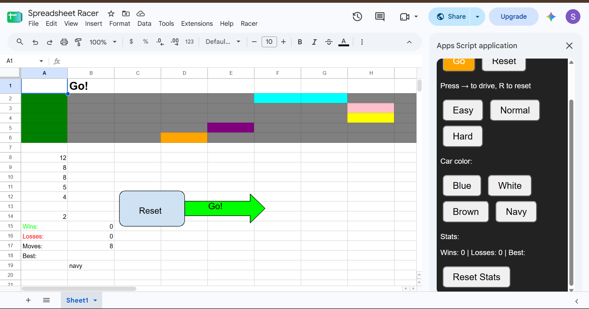

# Spreadsheet Racer

A racing game built entirely in Google Sheets with Apps Script. Every cell is a pixel, and you race your car against four computer cars, Pinky, Sunny, Grape and Blaze, from the green start line to the red finish line.

## How to play

1. Click **Reset** (the blue button under the track) so all five cars line up at the start. A 3-2-1-GO! countdown plays.
2. Open the **Racer** menu at the top of the sheet and choose **Open controls** to show the sidebar.
3. Press **Go!** (or the right arrow key) to move your car, the top lane, forward one cell. Every time you move, the opponents move a random number of cells.
4. Land on a **cyan boost** tile to jump 2 extra cells. Land on a **black oil slick** and you lose that turn's move.
5. The first car across the finish line wins, and the winner is announced above the track in its car's color.
6. Press **R** (or Reset) to start a new race.

## Features

- 5-lane race against 4 computer cars
- Sidebar controls, opened from the Racer menu
- Right arrow to drive, R to reset
- 3-2-1-GO! countdown
- Easy, Normal and Hard difficulty: opponents move 0–1, 0–2 or 0–3 cells per turn
- Boost tiles and oil slicks placed randomly in your lane each race
- Car color picker
- Wins, losses, current moves and best record (fewest moves to win)
- Live stats in the sidebar, with a Reset Stats button
- Go! is locked during the countdown and after the race ends

## How it works

- **Cells are pixels.** A car is one colored cell. To move it, the old cell is painted grey and the new cell is painted the car's color.
- **The sheet is the game's memory.** Apps Script functions forget everything when they finish, so each car's position is saved as a number in cells A8 to A12. A13 says "over" when Go! should do nothing (during the countdown and after a win), and A14 stores the difficulty.
- **One loop moves all four opponents.** In `MoveOpponents`, a `for` loop runs rows 3 to 6. Each time it reads that car's position, greys the old cell, picks a random number of steps with `Math.random`, paints the new cell and saves the position. That way I didn't have to write the moving code four times.
- **Countdown.** `SpreadsheetApp.flush()` and `Utilities.sleep(1000)` show each number one second apart.

## Bugs and fixes

- **Cars disappeared.** Opponent colors were being read off the sheet, and sometimes the color was lost. I moved the colors into a list in the code.
- **Cars duplicated.** Clicking Go! fast started two moves at once. `LockService` makes each click wait its turn.
- **Functions acted weird.** I had written `function test()` more than once. Apps Script only keeps the last function with a given name, so I gave every function its own name.

## What I learned

Before this, I had only used Apps Script for small things, like making my spreadsheets show stats for my school assignments. This was my first time building a full program, my first time using GitHub on my own, and my first time using VS Code. I learned the difference between `getValue` (reads what's in a cell) and `setValue` (puts a value into a cell), how `for` loops save you from repeating code, and how to track down a bug by testing one piece at a time.

## How to run it

**Option 1: copy my sheet**

1. Open [my Google Sheet](https://docs.google.com/spreadsheets/d/1EzfEF33IdzKTIjueAxb91w6ZQv2nZB_aEWSYRSKJxuI/edit?gid=0#gid=0).
2. Click **File → Make a copy**.
3. The first time you click a button, Google asks for permission. Click **Advanced**, then **Go to (your copy's name)**, then **Allow**.

**Option 2: build it yourself**

1. Create a new Google Sheet.
2. Go to **Extensions → Apps Script**.
3. Paste in `Code.gs` and add `Sidebar.html` from this repo.
4. Back in the sheet, insert two drawings: a Go button and a Reset button.
5. Assign `MovePlayer` to the Go button and `drawtrack` to the Reset button.
6. Optional: resize the columns and rows to 25 pixels so the cells look square.
7. Click **Reset** to start.

## Use of AI

I designed the game and wrote the core race loop myself, using hints from Claude. For the sidebar and later features (difficulty, tiles, stats, color picker), Claude supplied most of the code, which I adapted and tested. Claude also helped diagnose bugs from my screenshots. I logged 10.2 hours on it.
