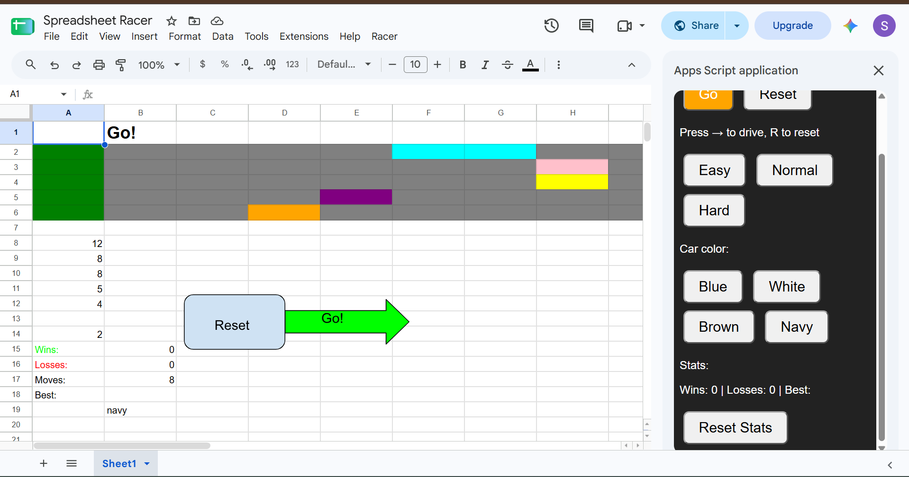

# Spreadsheet Racer

A racing game built entirely in Google Sheets with Apps Script.

## How to play
So, when you open the game, you will see one of 2 things, all the cars lined up at the starting line, or the cars are scattered all about the track. If that is the case, hit the big blue reset button under the track. Basically, it's ideal to see all of the cars lined up at their starting positions. Once there, at the top of the page you will see things like file or tools, in that row, you will also see one called Racer. When you click on it, it should say: open controls, click on that too. Once you completed the steps, a sidebar should appear on the side. The sidebar has many options to customize and play the game. Starting at the top, there is a go and reset button just like the one at the bottom of the road. These do the exact same things, but this time you can hit the right arrow on your keyboard to move forward an use the r or R key on your keyboard instead of the reset button. Under those buttons, you should see three more buttons: the Easy, Normal, and Hard modes. The Easy button makes you opponets move 0 to 1 spaces or cells each time you hit go. The Normal setting lets the opponents cars move 0 to 2 spaces or cells each time. Lastly, the Hard setting gives the opponents the ability to move 0 to 3 cells per button push. When you on Easy mode, the opponents cars are about half of your speed, so it will be easy and likly for you to win. On the Normal mode, your opponents are moving at the same speed that you are, so there is no telling who will win, it will be a close race. While on the Hard mode, your opponents will go 1.5 times your speed, so you will have to rely on boosts to win the race. That brings me to boosts and oil slicks. A boost is a light blue or cyan color that only appears on your track. This specific cell will boost you forward two cells. The oil slick will slow you down, essentially stalling you for one turn.  Lets go back to the sidebar, under the difficulty settings you will be met with some car color customization!!! It has numerous colors to choose from. You can change the color of you car by selecting your color then clicking go or reset. Use the reset option if you haven't started a race yet, but if you are in the middle of the race and decide to change colors, all you have to do is select your color then take you next turn a.k.a. hit go. Under those color customization buttons you will find your stats. Theses stats list three things: Your wins, your losses, and your best. Your best just counts the least amount of turns you've ever taken to win a race. Your wins and losses tell you how many matches you've won and lost. These stats can also be found under the racetrack, along with one more stat, your moves, this one just shows how many moves you've currently made during your current race. But back to the sidebar, you have your reset stats button. This button does exactly what you thing it does. It puts your wins, losses, and best and resets it back to ZERO. So, only do that if your positive you want to rest your score.
Heres another option though,
Your going to be met with 2 simple buttons on the bottom of the raceing track: the Reset button and the Go ! button. The reset has a simple function. It litteraly does exactly what you thing it does. It resets the entire track, but what does this mean? It means that every car that was on the track, includeing the one at the finish line will be transported back to begging of the race, a.k.a. the starting point or the big green spot on the track that signigfies the starting line. The next button is almost the opposite though. The Go! button makes you car which is the car at the top track, or the car on the first/top track go forward one cell every time you press it. This is the crucial step to finishing the race. But the button does more than just move your car, it actuveates your opponents! Your opponents will move at an unpredicted or random rate or number of cells each time you press the button.
## Features
5 lane race against 4 cpu cars
sidebar controls, opened from the racer menu
Right Arrow key to drive, R to reset
3-2-1-GO! countdown
Easy, Normal, Hard, difficulty
Boost tiles and oil slicks
car color picker
Win/Loss counter, move counter, and best record
Live stats in the sidebar
Winner announced in the car's color
So, the race has five lannes: your the one at the top lane, the rest are computer opporated cars. When you click Go! your car will move forward one cell. Your opponents will move a random 1-2 spaces each turn or each time you press Go!. The first car to get from the green start line to the red finish line first wins! The winner is announced in big text above the track, in the winners color a.k.a. the color of their car. The Reset button redraws the track and starts a 3-2-1-GO! countdown. The Go! button is blocked off from use until the countdown ends and after the race ends.
## How it works
The cells are pixels so every car is just a cell and a moving car means the cell it was just on gets painted grey and the cell its on gets painted the cars color. Each cars postion is stroed as a number in A8 to A12 since the functions forget where the postitioning is every time it finishes it. The Math.random picks 0, 1, or 2 cells to move for each opponent car. Opponent colors come from a list in the code instead of being read off a sheet, whcih fixed a bug where cars dissapeared. When the A13 cell says over, clicking Go! does litterly nothing. It's used during the countdown and after someone wins. LockServace makes fast double clicks wait there turn, which fixed a bug where cars are duplicated. The flush and sleep make the coutdown show each number one second apart.
## What I learned
I've only used Apps Script before. I use it to make my spreadsheets give me important stats for my assignments for school. As for Github, I know what it is but I've never used it before, whenever I've need it, I would ask one of my friends who knows how. But as for VSCode, I've litteraly never even heard of this software before. It was surprisingly easy to set up. I've learned the difference between getValue and setValue is that the set one litteraly sets the value like it gives it a value. But the get, obviosly gets the value or retreives it. If 2 functions have the same name when Apps Script loads the code, each function name is related to one section of code. If you write function test() five times, every new one replaces the one before it. Ony the last one is left. Before I put test functions for everything was showing up weired on my spreadsheet. The for loop in my game repeats teh same steps for each opponent, so I dont have to write the moving code 4 times. In MoveOpponents, row starts at 3 and goes up by 1 until it hits 6. Each time through, it moves the car in that row, and reads it's position, grey's the old cell, and gives random steps, paints teh new cell the color of the car, and saves it. So, one section of code moves all 4 opponent cars.
## How to run it
There are 2 ways to get my game!
Way #1
1. Use this link to my Google Spreadsheet: https://docs.google.com/spreadsheets/d/1EzfEF33IdzKTIjueAxb91w6ZQv2nZB_aEWSYRSKJxuI/edit?gid=0#gid=0 
2. Click File then make a copy
3. When you click a button google will ask for permission before you can keep going
4. Click advanced
5. Go to (Whatever your version of the project is called) and click Allow
Way #2
1. Create a new Google Sheet
2. Open extensions at the top of the page
3. Go to Apps Script
4. Paste in Code.gs from my GitHub repo
5. Insert 2 drawings, A go button and a reset button
6. assign MovePlayer to the go button and drawtrack to the reset button
7. Resize columns and rows to 25 sow teh cells look square(optional)
8. Click reset to start

There may be some AI features due to my first time ever coding and needing to learn :)
